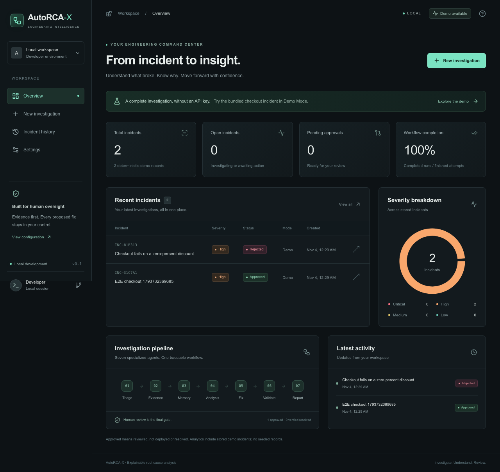
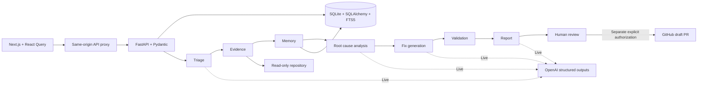

# AutoRCA-X

**Explainable root cause analysis, from error log to reviewed code fix.**

AutoRCA-X is a local, full-stack engineering workspace with a seven-agent LangGraph workflow. It connects logs, read-only source evidence, historical incidents, proposed changes, measured validation results, and human review. The deterministic demo runs without an API key or GPU.



## What works

- Next.js App Router dashboard with real SQLite-backed analytics, incident history, search, severity/status filters, and responsive dark UI.
- Incident submission, repository file selection, live progress through SSE, inspectable agent outputs, and downloadable JSON reports.
- Seven sequential LangGraph agents: triage → evidence → memory → analysis → fix → validation → report.
- Demo diagnosis of the deliberately broken percentage-discount implementation, a unified/split diff, and actual failing-before/passing-after regression tests.
- Persistent approval/rejection with source-version checks. Approval does **not** apply code, commit, deploy, or mark a production incident resolved.
- Live OpenAI structured outputs validated with Pydantic, with explicit partial results on provider or agent failures.
- SQLite FTS5/BM25 retrieval of previous investigations. Historical proposals and review decisions are labeled; they are not represented as successful deployed fixes.
- Optional, separately authorized GitHub draft PR creation using a backend-only fine-grained access token.

This is a working **single-user local MVP**, not an internet-facing production service. See the security and verification limitations below.

## Quick start on macOS

Requirements: Python 3.10+ (3.12 recommended), Node.js 22.12+ or 24+, npm, and SQLite with FTS5 (included in the tested Python environment). No GPU, Docker, or API key is needed for the demo.

From the repository root:

```bash
cp .env.example .env
python3 -m venv backend/.venv
backend/.venv/bin/pip install -r backend/requirements.lock
cd frontend
npm ci
cd ..
```

Terminal 1, from the project root:

```bash
backend/.venv/bin/uvicorn app.main:app --app-dir backend --host 127.0.0.1 --port 8000
```

Terminal 2:

```bash
cd frontend
npm run dev
```

Open **http://127.0.0.1:3000**. FastAPI documentation is at **http://127.0.0.1:8000/docs**. The frontend forwards `/api/*` requests to FastAPI through a same-origin server route. Credentials are never placed in `NEXT_PUBLIC_*` variables.

The SQLite database is created at `data/autorca.db` relative to the backend process working directory. Always launch the backend from the project root for a consistent location. Alembic migrations run automatically at startup. Use **one Uvicorn worker**; the local background-task runner marks interrupted work failed on restart and preserves completed agent outputs.

The build uses Next.js's supported Webpack option because this execution environment restricts Turbopack's local CSS worker socket.

## Demo walkthrough

1. Open **New investigation** and click **Load sample incident** (or select **Explore the demo** on the dashboard).
2. Leave **Bundled checkout application** and **Demo · deterministic** selected. Start the investigation.
3. Expand agent outputs and evidence. The submitted log references `checkout.py:3`, where a zero discount becomes a zero divisor.
4. Read the root cause: the function should apply a **percentage reduction**, according to its docstring and bundled README. Merely avoiding division by zero would not fix its other incorrect outputs.
5. Open **Review fix**. The proposed formula is `price * (1 - discount / 100)`, with documented range guards.
6. Inspect the actual before/after regression output. The original has two failures and two errors; the fix passes four tests covering zero, partial, full, and invalid discounts.
7. Approve or reject and add an optional note. Refresh to verify persistence. The original sample file is unchanged.
8. Find the incident in history. Run another investigation to retrieve the first through FTS5.

Demo mode only diagnoses the exact bundled scenario. Other submitted logs produce a limited report and do not receive a fabricated fix. Analytics start from stored records, including clearly labeled demo investigations; there are no hardcoded metrics. “Approved” and “workflow completed” do not mean production resolution.

## Configuration

Backend settings are loaded from the project-root `.env`, with environment variables taking precedence. Restart the backend after environment changes.

| Variable | Default | Purpose |
| --- | --- | --- |
| `OPENAI_API_KEY` | empty | Enables Live AI Mode; server only |
| `OPENAI_MODEL` | `gpt-4.1-mini` | Initial model; must support structured outputs and be available to your account |
| `DATABASE_URL` | `sqlite:///./data/autorca.db` | SQLite database location |
| `REPOSITORY_ROOT` | empty | Absolute path to a local source repository; no arbitrary paths from the browser |
| `GITHUB_TOKEN` | empty | Fine-grained token; server only |
| `GITHUB_REPOSITORY` | empty | `owner/repository` corresponding to the configured local source |
| `GITHUB_BASE_BRANCH` | `main` | PR target branch |
| `AUTORCA_API_TOKEN` | empty | Optional shared server-to-server API authentication |

Frontend server settings belong in `frontend/.env.local`:

```dotenv
BACKEND_URL=http://127.0.0.1:8000
# Set to the same value as the backend if API authentication is enabled:
AUTORCA_API_TOKEN=
```

The Settings page persists the model, default investigation mode, evidence file limit, and historical match limit. Each investigation snapshots these values at start. A saved model preference overrides the environment default. Credentials can only be configured through backend environment variables; the UI receives availability flags, not secrets.

### Live AI Mode

Set a valid API key, configure a source repository if desired, restart FastAPI, and choose **Live AI** when submitting. Redacted logs and collected source files are sent to OpenAI. Triage, analysis, fix generation, and report narration call `client.responses.parse` with Pydantic schemas. Evidence collection, retrieval, and validation remain deterministic application code inside the same LangGraph.

The implementation follows the official [OpenAI structured outputs documentation](https://developers.openai.com/api/docs/guides/structured-outputs) and [LangGraph graph API](https://docs.langchain.com/oss/python/langgraph/graph-api). External text is supplied as untrusted data beneath system instructions, without tool or shell access. Evidence IDs and patch target paths are verified locally; generated explanations remain hypotheses requiring review.

Live tests use mocked structured responses and provider failures. **An actual paid model request has not been verified in this workspace**, because no credentials were supplied. There is no silent fallback to demo results when live generation fails.

### GitHub integration

1. Configure a local repository root and its corresponding `owner/repository`.
2. Create a fine-grained token restricted to that repository with **Contents: read/write**, **Pull requests: read/write**, and the mandatory metadata permission. Configure it as `GITHUB_TOKEN` on the backend.
3. Investigate a local file. The reviewed original must match the target GitHub base file byte-for-byte.
4. Approve the fix in the UI, then separately check the authorization box and click **Create draft pull request**.

The operation creates a deterministic `autorca/<incident-id>` branch, a single-file commit, and a draft PR through GitHub REST. It does not merge or deploy. Retry logic reuses an existing branch/PR and refuses to overwrite a changed target file. A network failure can leave a branch or commit behind; the UI reports that possibility. Do not put secrets into review titles or notes. Repository workflows may execute in response to commits/PRs; only authorize a target whose CI you trust.

GitHub HTTP behavior is covered with mocked responses. **No real remote branch, commit, or pull request has been created or verified.**

## Architecture



`StateGraph` maintains typed workflow state. Each agent saves its execution, duration, output, and safe error description before continuing. SSE streams persisted snapshots; polling is a fallback. Failed agents do not discard earlier evidence. Fix generation is blocked if required triage/evidence/analysis failed. Restarts mark unfinished work failed; there is no automatic graph replay or durable task queue in this version.

Data models include incidents, investigations, proposed fixes, agent executions, incident memory, and preferences. Foreign keys and indexes are enabled. Alembic's initial migration is a frozen schema snapshot and creates the FTS5 virtual table. SQLite is the supported database today. The `Retriever` protocol provides a replacement boundary for a future PostgreSQL/pgvector implementation; changing `DATABASE_URL` alone does not add PostgreSQL support.

```text
frontend/src/app/                 Six screens and same-origin API proxy
frontend/src/components/          UI shell, shadcn-style Radix button, reports
frontend/src/hooks/use-incident.ts SSE + React Query progress
backend/app/api/routes.py         REST API and approval guards
backend/app/agents/workflow.py     Seven-agent LangGraph
backend/app/schemas/contracts.py   Validated input and AI output schemas
backend/app/services/             LLM, retrieval, repository, validation, GitHub
backend/app/models/records.py     SQLAlchemy records
backend/migrations/               Alembic migrations
examples/buggy-python-app/        Intentional bug, contract, regression tests
backend/tests/                    API, workflow, security, integration tests
frontend/e2e/                     Playwright critical workflows
docs/                            API, security, sandbox, verification notes
```

## Testing and builds

From the root:

```bash
PYTHONPATH=backend backend/.venv/bin/pytest backend/tests -q
```

Frontend:

```bash
cd frontend
npm test
npm run typecheck
npm run build
npx playwright install chromium
npm run test:e2e
```

Playwright starts FastAPI and Next.js and uses a separate database under `frontend/test-results/`. Stop manually started servers first to avoid reusing a development database, or run `CI=1 npm run test:e2e` to require dedicated servers. Tests exercise sample submission, report/evidence/diff display, actual regression outputs, approval/rejection persistence, history, settings, and a mobile viewport. No tests call real OpenAI or GitHub services. See [verification notes](docs/verification.md) for observed results and limits.

To reproduce the deliberately failing sample independently:

```bash
cd examples/buggy-python-app
python3 -m unittest -v test_checkout
```

That command is **expected to fail**. The application demonstrates the successful counterpart in a temporary controlled fixture; it never rewrites the sample in place.

Production frontend smoke run:

```bash
cd frontend
npm run build
npm start
```

## Docker

```bash
docker compose up --build
```

The compose stack exposes the UI on `127.0.0.1:3000` and the API on `127.0.0.1:8000`, with a persistent database volume. Docker is optional and this stack has not been executed in the current workspace. Application containers are **not** arbitrary repository execution sandboxes. A separate trusted sample image and the future runner boundary are documented in [docs/sandbox.md](docs/sandbox.md).

## Security and current limits

- Bind both services to loopback. There are no user accounts, tenant isolation, or internet-facing authorization controls. The optional API token protects the backend; the local frontend proxy is not a user login boundary.
- Analysis reads allowlisted text files only. Hidden/secret-looking files, symlinks, traversal paths, oversized files, and common ignored directories are rejected. Scanning and file selection are bounded.
- Logs and model output are redacted for common secret patterns. This is best-effort detection, not a guarantee that all credentials or personal data are removed. Inspect inputs before sending them to an external provider.
- Patches target one collected file and are tied to a SHA-256 original version. Files containing recognized secrets cannot be proposed for editing.
- No model tool calls, arbitrary shell commands, automatic repository edits, commits, PRs, merges, or deployment.
- Only the exact application-owned demo constants may execute in a temporary test directory. Untrusted repositories and AI-generated variations receive syntax/version checks; execution is explicitly skipped. This temporary directory is **not** a security sandbox.
- Python AST parsing checks syntax, not safety or business correctness. Non-Python syntax checks are skipped. Model explanations can be wrong even with valid citations.
- The local background runner is single-process. Jobs interrupted by restart retain partial outputs but require a new incident to rerun. There is no cancellation, durable queue, or rate limiting yet.
- Database backups, disk encryption, retention policy, and server access control are the operator's responsibility.

Recommended next milestone: add an authenticated durable job service and an isolated, resource-limited test runner with explicit command authorization; then validate Live AI and GitHub against a disposable repository using real credentials. Follow with verified resolution tracking, evaluation datasets, multi-file patches, and a pgvector retriever.
